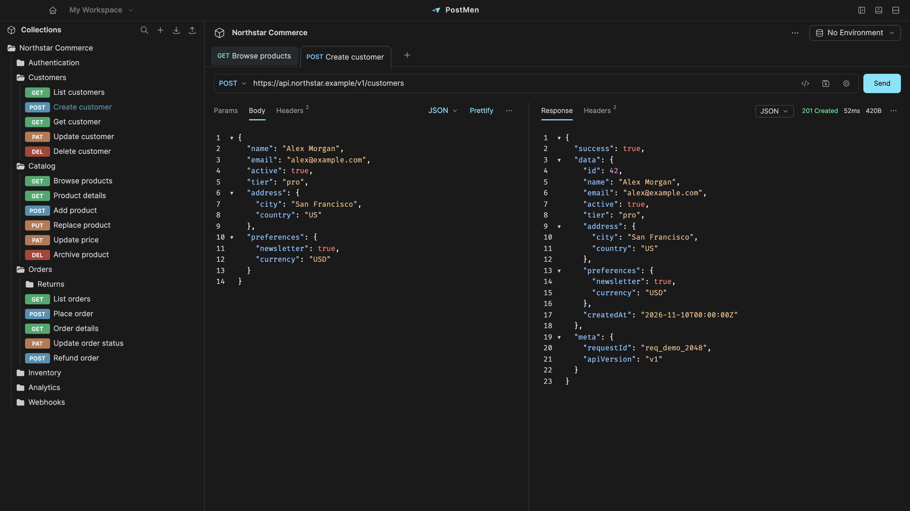

<p align="center">
  
</p>

<h1 align="center">PostMen</h1>

<p align="center">A local-first desktop REST API client built with Tauri 2, Vue 3, TypeScript, Rust and SQLite.</p>



## Features

- Organize requests in independent workspaces, collections and nested folders. Search, reorder, clone, and move requests; select several with Cmd on macOS or Ctrl on Windows/Linux, then drag them into a folder.
- Edit URLs, query parameters, headers, JSON/raw or multipart bodies, and local file attachments. Each open request keeps its own draft and undo history.
- Use Collection and Global environments with `<<variable>>` placeholders in URLs, parameters and headers. Collection values override Global values.
- Send requests through native Rust HTTP and inspect response status, timing, headers and body. Cancel requests, review execution history, and restore the last result for each request.
- Import Postman Collection v2.0/v2.1 JSON, export v2.1 JSON, create requests from cURL, and generate cURL from a draft.
- Choose light, dark or system theme; use keyboard shortcuts and saved window layout. Quit warns about unsaved drafts.
- Right-click a request tab and choose **Close Others** to keep and activate it. Dirty drafts in other tabs get one Save All / Discard / Cancel prompt; active target requests require cancellation confirmation.

## Development

On macOS, install Xcode Command Line Tools, Rust/Cargo and npm. macOS 14+ and Rust 1.92.0 are the tested setup. Node must satisfy `>=22.22.2 <23 || >=24.15.0` from `package.json`. Windows/Linux builds have not been verified.

```sh
npm ci
npm run tauri:dev
```

Tauri starts Vite at `127.0.0.1:1420`. `npm run dev` provides a browser preview without native storage or HTTP. Restart native dev after Rust, command or configuration changes.

### Build and checks

```sh
npm run build                         # Frontend typecheck and build
npm run lint
npm test
npm run test:rust
npm run tauri:build -- --bundles app   # macOS application bundle
```

The app bundle is `src-tauri/target/release/bundle/macos/Postmen.app`. Local bundles are not notarized for distribution. Browser end-to-end tests use `npm run test:e2e` and require Playwright browsers.

## Using PostMen

- Create or switch workspaces from the title-bar dropdown. The default workspace opens at startup; saved tabs are restored per workspace.
- Use Cmd/Ctrl-click to select multiple requests in one collection, then drag a selected request onto a folder. If any selected request has unsaved changes, choose **Save All & Move** or **Cancel**.
- Right-click a request tab and choose **Close Others**. The clicked tab keeps its draft and response; other drafts are saved or discarded only after confirmation, and running target requests are cancelled only after confirmation.
- Enter `<<name>>` in a URL, query parameter or header to use an environment variable. Body and multipart values are not substituted.
- Use the sidebar arrows to import or export collections. Import previews validation warnings; export asks before overwriting files.
- Click the `</>` icon beside Save to preview and copy cURL for the current draft. Review resolved credentials and local file paths before sharing it.
- Reopen a request to see its last completed result without sending it again. The timestamp identifies historical output, which may not match the current saved request or unsaved draft. The latest completed result replaces the previous one, including HTTP errors, timeouts, transport errors and cancellations.

| Action | Shortcut |
| --- | --- |
| Send request | `Cmd/Ctrl + Enter` |
| Save request | `Cmd/Ctrl + S` |
| Close request tab | `Cmd/Ctrl + W` |
| Next / previous tab | `Ctrl + Tab` / `Ctrl + Shift + Tab` |
| Toggle sidebar | `Cmd/Ctrl + B` |
| Toggle response layout | `Cmd/Ctrl + Shift + L` |

## Data and safety

Development and production keep separate SQLite data and window state on macOS:

```text
Production:  ~/Library/Application Support/com.postmen.desktop/
Development: ~/Library/Application Support/com.postmen.desktop.dev/
```

The profile contains `postmen.sqlite3` for the initial workspace, `workspaces/<UUID>/postmen.sqlite3` for additional workspaces, and `workspaces.v1.json` for the catalog. Back up the entire profile with the app closed, including SQLite sidecar files.

Data is stored locally as **plaintext**, not in an encrypted vault. The last completed result for each saved request includes its response body preview and headers, which may contain credentials or other sensitive data. PostMen stores up to 1 MiB of decompressed body preview and applies header limits; truncation and binary notices remain visible with the restored result. This is not a full response archive: execution history contains metadata only, and older history entries cannot restore bodies or headers.

Closing a tab clears its in-memory result, but the saved result remains available when the request is reopened. Deleting a request removes its saved result; history cleanup does not. If saving a result fails, the live result remains visible with a warning, but a later restart may show the previous saved result. Restore failures are shown separately and can be retried.

Unsaved drafts and undo history exist only in memory and may be lost after a crash or force-quit. Workspace deletion removes the entry from the app but retains its database files, including saved results, for manual recovery; there is no in-app Restore action. Legacy application databases are not migrated.

## Repository and license

`frontend/src/` contains the Vue UI, Pinia stores and typed IPC. `src-tauri/` contains the Rust backend, SQLite and native integration. `tests/e2e/` contains browser regression tests.

MIT — see [LICENSE](LICENSE). Asset and dependency attribution is in [THIRD_PARTY_NOTICES.md](THIRD_PARTY_NOTICES.md). PostMen is an independent project and is not affiliated with Postman.
